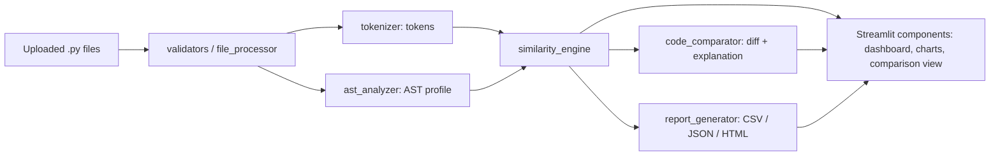

# CodeSimilarity — Python Code Similarity & Plagiarism Analysis Tool

## 1. Introduction
CodeSimilarity is a Streamlit web app that compares Python source files pair by pair and highlights code that may deserve a closer human look. It runs locally and needs no database, account or internet connection.

## 2. Problem statement
Checking many student submissions by eye is slow, and simple text diffing is easily defeated by renaming variables, changing indentation or adding comments. Teachers need a quick, explainable way to find similar submissions, and students need to understand why two programs look alike.

## 3. Objectives
- Compare every unique pair of uploaded `.py` files with three different methods.
- Stay robust against formatting, comment and (optionally) identifier changes.
- Explain results visually (matrix, charts, side-by-side view) and in plain language.
- Handle untrusted input safely: uploaded code is **never executed**.
- Export results as CSV, JSON and HTML.

## 4. Key features
- Multi-file upload with validation (`.py` only, ≤ 20 files by default, ≤ 1 MB each, ≤ 10 MB total, empty/binary/duplicate handling).
- Token, TF-IDF and AST structural similarity plus a configurable weighted score.
- Interactive Plotly similarity matrix, score distribution and score breakdown.
- Side-by-side viewer with Pygments highlighting, line numbers and diff colouring (HTML-escaped).
- Sortable/filterable results table; failed files and skipped pairs listed separately.
- Session-only history, settings panel, downloadable reports, automated tests.

## 5. Technology stack
Python 3.11+, Streamlit, Plotly, Pygments, `ast`, `tokenize`, scikit-learn (TF-IDF, cosine), NumPy, Pandas, pytest.

## 6. System architecture

```
app.py            entry point and page routing
analyzer/         file_processor, tokenizer, ast_analyzer, similarity_engine, code_comparator, report_generator
components/       sidebar, upload_section, dashboard, comparison_view, charts, styles
utils/            validators, helpers (thresholds, classification, formatting)
tests/            pytest suite
```

## 7. Algorithm explanation
**Text vs token vs AST (beginner version)**
- *Text similarity* compares characters/lines. Rename `total` to `acc` and it drops sharply.
- *Token similarity* first splits code into Python tokens (`def`, `total`, `+=`, …) and ignores comments and spacing.
- *AST similarity* compares the program's shape (functions, loops, conditions) after parsing, so it survives renamed variables and reformatting.

**Preprocessing**
- *Method A – normalized source:* comments removed with `tokenize` (a `#` inside a string is untouched), line endings normalized, trailing spaces and blank lines removed; multi-line strings are left intact. Used for the line diff.
- *Method B – tokens:* comments/blank-line tokens dropped; `NEWLINE/INDENT/DEDENT` kept as markers (indentation width does not matter).
- *Optional identifier normalization:* user-defined names become `ID_1, ID_2…` by first appearance. Keywords, built-ins, attribute names (`.append`), dunder names, imported names, strings and numbers are never replaced.
- *Method C – AST:* `ast.parse` builds a tree; features are parent→child node pairs, hashes of every statement subtree, and identifiers (`ID` when normalized).

**Measurements (each 0–100)**
- Token: Dice coefficient over token 3-grams.
- TF-IDF: `TfidfVectorizer` with a custom analyzer (token unigrams + bigrams) so operators and one-letter names are kept; cosine similarity.
- AST: weighted Jaccard, Σmin / Σmax over the feature multisets.

If any enabled method cannot produce a score for a pair, the combined score is left empty and the pair is marked *incomplete* — it is never treated as 0.

## 8. Similarity-score formula
```
Combined = Token × 0.30 + TF-IDF × 0.20 + AST × 0.50
```
The weights are heuristic defaults, adjustable in Settings. Disabled methods are dropped and the rest are rescaled to total 100% (e.g. without TF-IDF: Token 37.5%, AST 62.5%).

Classification (adjustable; half-open ranges, so no gaps or overlaps): Low [0, 25), Moderate [25, 50), High [50, 75), Very High [75, 100]. **These are review indicators, not proof of plagiarism.**

## 9. Installation
```
python -m venv .venv
.venv\Scripts\Activate.ps1          # Windows PowerShell
source .venv/bin/activate           # macOS / Linux
pip install -r requirements.txt
```

## 10. Running
```
pytest                              # run the tests
streamlit run app.py                # start the app (opens http://localhost:8501)
```

## 11. Using the app
1. Open **New Analysis**, upload two or more `.py` files, remove any you don't want.
2. Optionally open **⚙️ Settings** in the sidebar (methods, weights, thresholds, limits, identifier normalization).
3. Click **Analyze files**. Results open automatically.
4. In **Comparison Results**, study the charts and matrix, filter/sort the table, then click a matrix cell or select a table row and press *View comparison*.
5. Download CSV / JSON / HTML reports (they contain no source code).
6. **Dashboard** shows session statistics; **Analysis History** lets you reopen earlier results (temporary).

## 12. Example test cases (`pytest`)
Identical code → 100%; formatting/comment changes → ≥ 95%; renamed variables → 100% token/AST with normalization; different algorithms → low; syntax error → reported, no crash; empty files rejected; 5 files → 10 pairs; normalization keeps keywords/strings/attributes/built-ins; uploaded code never executed; HTML output escaped.

## 13. Limitations
- Scores measure similarity, not intent. Templates, tutorials and standard algorithms (e.g. bubble sort) often match.
- Identifier normalization is a heuristic (e.g. keyword-argument names are also numbered; names are numbered by first appearance, so reordering definitions lowers the score).
- AST similarity ignores literal values and cannot judge whether programs behave the same.
- The line diff does not detect moved blocks; the viewer shows the first 3,000 lines per file.
- Token and AST analysis cap very large files (300,000 tokens / syntax nodes).
- Heatmap cell click depends on browser/Plotly selection support; the table row selector is the fallback.
- Python 3 source only. No cross-file/web plagiarism search.

## 14. Future enhancements
Winnowing/fingerprint matching across many files, moved-block detection, support for other languages, optional persistent storage with consent, per-function comparison, batch ZIP upload.

## 15. Troubleshooting
- `python --version` must be 3.11 or newer.
- PowerShell blocks activation: `Set-ExecutionPolicy -Scope CurrentUser RemoteSigned`.
- `pip install` fails on scikit-learn: upgrade pip (`python -m pip install -U pip`) or use a supported Python version (3.11–3.13).
- Port busy: `streamlit run app.py --server.port 8502`.
- `ModuleNotFoundError: analyzer`: run commands from the project root.

## 16. Course-project disclaimer
This is a B.Tech course project for learning and demonstration. It is not a certified plagiarism-detection service. Always review flagged pairs manually and follow your institution's academic-integrity process before drawing conclusions.
